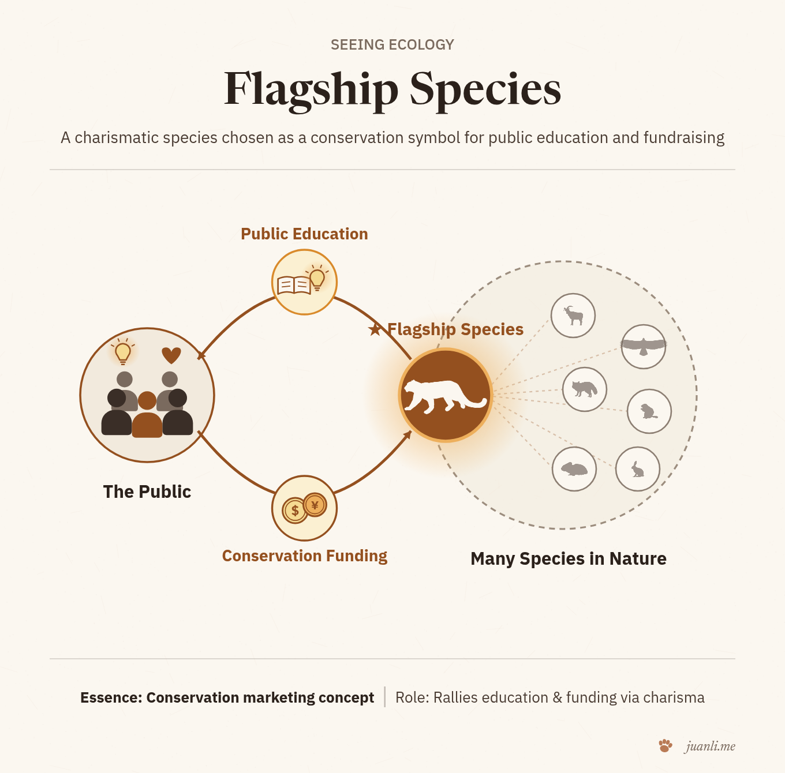
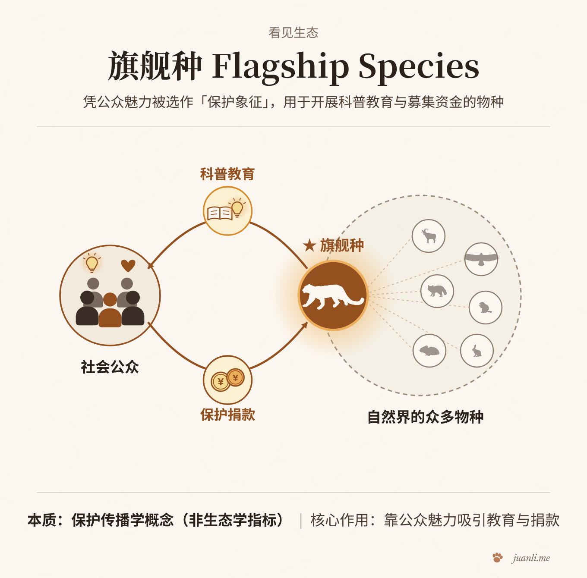

# Juan Li · Seeing Ecology (看见生态)

**[English](README.md) | [简体中文](README.zh-CN.md)** · **[Live Portal (中文)](https://juanli.me/seeing-ecology/) · [Live Portal (EN)](https://juanli.me/seeing-ecology/en/)**

[](https://juanli.me/seeing-ecology/)
[](https://juanli.me/seeing-ecology/en/)
[](https://juanli.me/seeing-ecology/llms.txt)
[](LICENSE)

> **Seeing Ecology (看见生态)** is a bilingual (English & Chinese) collection of visual, interactive explainers for timeless concepts, principles, and models in ecology and conservation biology — seeing the phenomenon and structure first, then returning to the verbatim definitions, boundary conditions, controversies, and metrics in primary literature.

<p align="center">
  
  
</p>

---

## 1. Why Seeing Ecology?

Textbooks and encyclopedias often flatten ecological concepts into static definitions, leaving students and researchers to conflate distinct mechanisms (for example, treating **Flagship species**, **Umbrella species**, and **Keystone species** as interchangeable synonyms for "important conservation species").

**Seeing Ecology** is built around five design and scholarly commitments:
1. **Primary-Literature Grounded**: Every definition, positive/negative example, historical milestone, controversy, and mathematical metric is verified against the original peer-reviewed paper (with direct DOI links and verbatim quotes).
2. **One Cognitive Turning Point per Card**: Each hero animation isolates the single causal or structural mechanism that defines the concept.
3. **Phenomenon Before Terminology**: Readers observe what happens when a species is removed, how a reserve boundary encloses co-occurring species, or how public appeal mobilizes conservation funding *before* formal labels appear.
4. **Minimal-Difference Pairs & Boundary Cases**: Every concept is sharpened by contrasting positive examples against near-miss negative examples and context-dependent boundary cases (e.g., *Pisaster* sea stars acting as a keystone predator on wave-exposed rocky shores vs. non-keystone on sheltered sandy bottoms; *Menge et al. 1994*).
5. **Layout Does the Explaining**: Strict adherence to *"Avoid unnecessary secondary labels and descriptions. Let the layout do the explaining."*

---

## 2. Bilingual Concept Index

| Concept (EN / 中文) | Core Criterion | Primary Literature Anchors | Interactive Explainers |
| :--- | :--- | :--- | :--- |
| **Habitat fragmentation**<br>生境破碎化 | Landscape-scale breaking apart of habitat into smaller, isolated patches, strictly separating spatial configuration *per se* (at fixed habitat amount *H*) from total habitat loss. | Wilcove et al. (1986) · Fahrig (2003, 2017) · Haddad et al. (2015) · Fletcher et al. (2018) · Gonçalves-Souza et al. (2025) | [English](https://juanli.me/seeing-ecology/habitat-fragmentation/en/) · [中文](https://juanli.me/seeing-ecology/habitat-fragmentation/zh/) |
| **Flagship species**<br>旗舰种 | Chosen as the focus of a conservation marketing campaign based on traits appealing to a target audience to mobilize attention and funding. | Heywood (1995) · Walpole & Leader-Williams (2002) · Veríssimo et al. (2011) · McGowan et al. (2020) | [English](https://juanli.me/seeing-ecology/flagship/en/) · [中文](https://juanli.me/seeing-ecology/flagship/zh/) |
| **Umbrella species**<br>伞护种 | A candidate species whose conservation is expected to confer protection to a large number of naturally co-occurring species; actual umbrella effectiveness requires empirical validation. | Wilcox (1984) · Fleishman et al. (2000) · Andelman & Fagan (2000) · Roberge & Angelstam (2004) | [English](https://juanli.me/seeing-ecology/umbrella/en/) · [中文](https://juanli.me/seeing-ecology/umbrella/zh/) |
| **Keystone species**<br>关键种 | Its impact on the community or ecosystem is large, and disproportionately large relative to its own abundance. | Paine (1966, 1969, 1980) · Power et al. (1996) · Libralato et al. (2006) · Estes et al. (2011) | [English](https://juanli.me/seeing-ecology/keystone/en/) · [中文](https://juanli.me/seeing-ecology/keystone/zh/) |
| **Biodiversity credits**<br>生物多样性信用 | A certificate representing a measured, evidence-based positive biodiversity outcome that is additional and durable. Frameworks differ on how credits may be used; this page focuses on voluntary, non-offset credits used for nature contributions. | KMGBF (2022) · Peng et al. (2024, 2026) · Wauchope et al. (2024) · Wunder et al. (2025) | [English](https://juanli.me/seeing-ecology/biodiversity-credits/en/) · [中文](https://juanli.me/seeing-ecology/biodiversity-credits/zh/) |
| **Indicator species**<br>指示种 *(Upcoming)* | Its presence, abundance, or physiological state reflects environmental conditions, disturbance, or community richness. | Landres et al. (1988) · Caro & O'Doherty (1999) | *In preparation* |
| **Metapopulation & source–sink**<br>集合种群与源-汇动态 *(Upcoming)* | Spatially discrete local populations connected by dispersal, persisting through the balance of extinction and recolonization. | Levins (1969) · Pulliam (1988) · Hanski (1998) | *In preparation* |
| **Trophic cascade**<br>营养级联 *(Upcoming)* | Indirect top-down predator effects across two or more trophic links releasing primary producers. | Paine (1980) · Carpenter et al. (1985) · Ripple et al. (2016) | *In preparation* |
| **Ecological niche**<br>生态位 *(Upcoming)* | The *n*-dimensional hypervolume of environmental conditions and resources permitting positive population growth. | Grinnell (1917) · Elton (1927) · Hutchinson (1957) · Soberón (2007) | *In preparation* |

---

## 3. Public Machine-Readable Endpoints (`LLMs.txt` · `JSON v1` · RSS)

Seeing Ecology exposes lightweight, read-only public endpoints directly from the website (no standalone Agent Skill required and no API key required):

- **`llms.txt` (Concise Markdown Index)**: [`https://juanli.me/seeing-ecology/llms.txt`](https://juanli.me/seeing-ecology/llms.txt)
- **`llms-full.txt` (Complete Concept Graph Reference)**: [`https://juanli.me/seeing-ecology/llms-full.txt`](https://juanli.me/seeing-ecology/llms-full.txt)
- **Concepts JSON API (`v1`)**: [`https://juanli.me/seeing-ecology/api/v1/concepts.json`](https://juanli.me/seeing-ecology/api/v1/concepts.json)
- **Bidirectional Graph JSON API (`v1`)**: [`https://juanli.me/seeing-ecology/api/v1/graph.json`](https://juanli.me/seeing-ecology/api/v1/graph.json)
- **RSS Feeds**: [`feed.en.xml`](https://juanli.me/seeing-ecology/feed.en.xml) · [`feed.zh.xml`](https://juanli.me/seeing-ecology/feed.zh.xml)

---

## 4. Citation & License

- **Code & Agent Scripts**: [MIT License](LICENSE)
- **Visual Explainers, Illustrations & Text**: [CC BY 4.0](LICENSE) — free to use in university lectures, school teaching, and academic talks with attribution to **Juan Li · Seeing Ecology (`https://juanli.me/seeing-ecology/`)**.

```bibtex
@software{li_seeing_ecology_2026,
  author       = {Li, Juan},
  title        = {{Juan Li · Seeing Ecology: Bilingual Visual and Interactive Explainers of Core Ecology Concepts}},
  year         = {2026},
  url          = {https://juanli.me/seeing-ecology/},
  note         = {GitHub repository: https://github.com/sahmoli/seeing-ecology}
}
```

---

## 5. Related Open Projects by Juan Li

- **[Juan Li · Academic Homepage](https://juanli.me/)** — Research on conservation biology, spatial ecology, snow leopards, and human–wildlife coexistence at XJTLU.
- **[Juan Li · AI4Science](https://juanli.me/ai4science/)** ([`sahmoli/ai4science-skill`](https://github.com/sahmoli/ai4science-skill)) — Bilingual, source-grounded daily intelligence index on how AI is transforming scientific research.
- **[Juan Li · AI4Education](https://juanli.me/ai4education/)** ([`sahmoli/ai4education-skill`](https://github.com/sahmoli/ai4education-skill)) — Bilingual, source-linked reading notes on AI in university, K-12, and family education.
