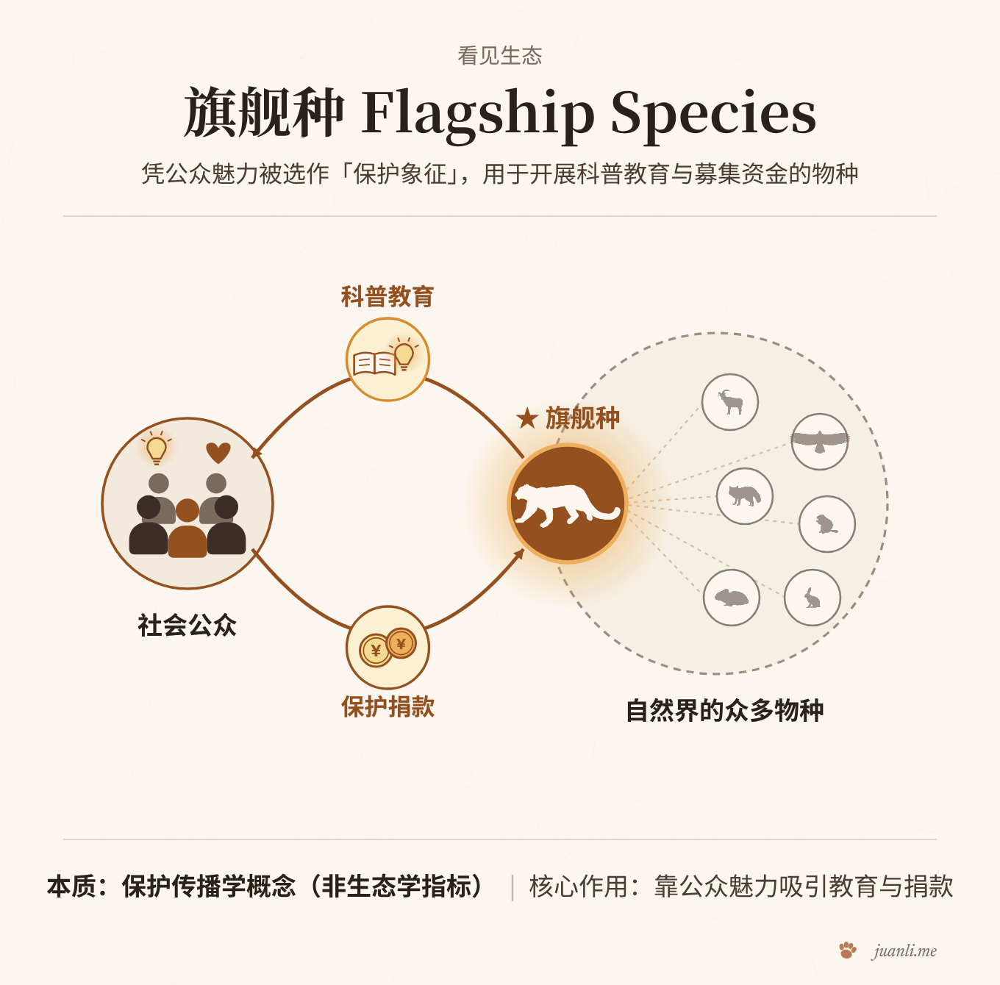
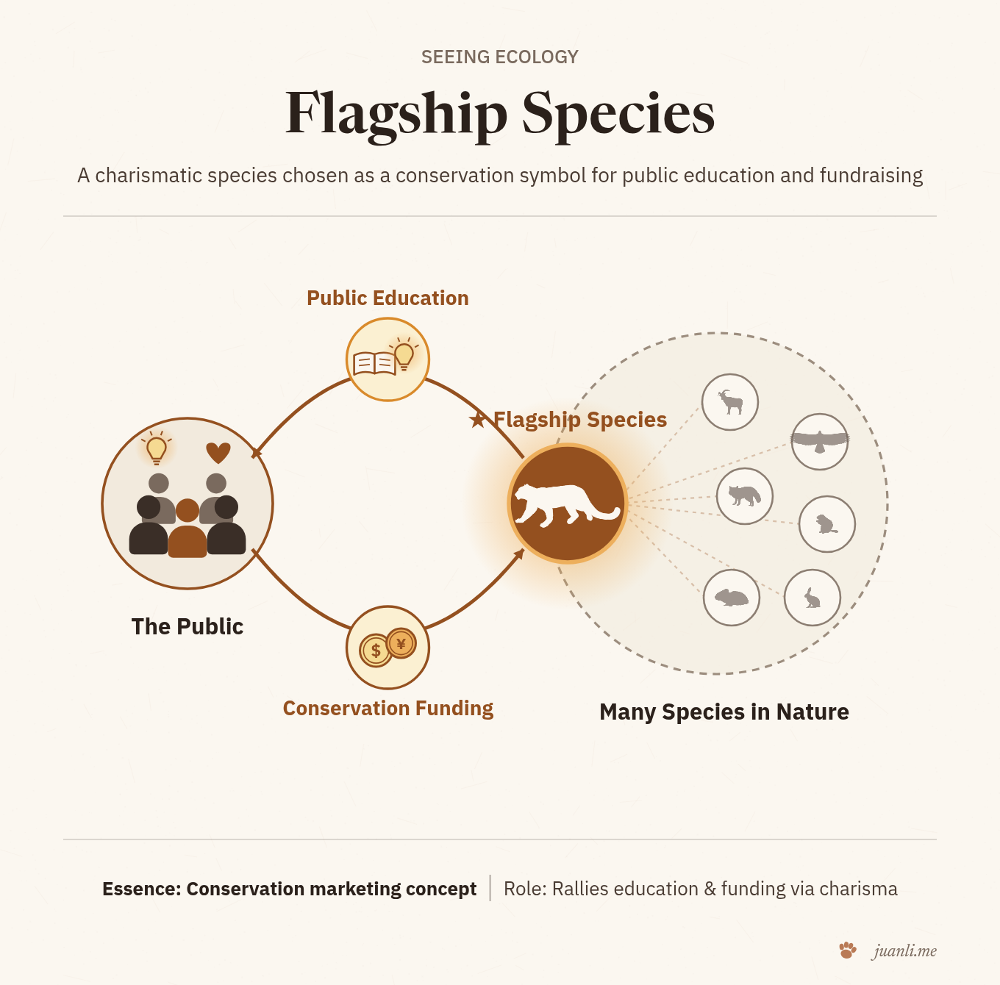

# Juan Li · Seeing Ecology（看见生态）

**[English](README.md) | [简体中文](README.zh-CN.md)** · **[在线主页（中文）](https://juanli.me/seeing-ecology/) · [English Portal](https://juanli.me/seeing-ecology/en/) · [Agent 接入页](https://juanli.me/seeing-ecology/agent/)**

[](https://juanli.me/seeing-ecology/)
[](https://juanli.me/seeing-ecology/)
[](https://juanli.me/seeing-ecology/agent/)
[](LICENSE)

> **看见生态（Seeing Ecology）** 是一套面向生态学与保护生物学经典概念、原理与模型的**中英双语极简视觉与交互图解**——先看见现象与结构，再回到原始文献的定义、边界、争议与度量。

<p align="center">
  
  
</p>

---

## 1. 理念与设计原则

教科书与普通百科常把生态学概念压缩成静态背诵条文，导致许多学者与学生将机制完全不同的概念混为一谈（例如把**旗舰种 Flagship**、**伞护种 Umbrella** 与 **关键种 Keystone** 笼统混作“重要保护物种”）。

**Seeing Ecology** 坚持五项学术与视觉准则：
1. **逐条锚定一手原始文献**：每一条定义、正反例物种、历史演进节点、学术争议与数学度量公式，均回到原始同行评审论文逐句核查（附 DOI 与原文引文）。
2. **一卡一认知转折点**：每张主视觉交互卡只聚焦决定该概念成立的唯一核心因果或空间结构。
3. **先现象，后术语**：先看见移走物种后的群落级联、大生境边界对同域物种的包络、或公众感召向保护资金的转化，最后才落出术语与判据。
4. **最小差异正反例对与条件边界**：每个概念均并排呈现正例、仅差一项核心特征的反例、以及随环境条件翻转的边界案例（如赭色海星在浪击岩岸为关键种，在背浪沙底则否；*Menge et al. 1994*）。
5. **让版面自己说话**：严格遵循 *"Avoid unnecessary secondary labels and descriptions. Let the layout do the explaining."*

---

## 2. 双语概念索引

| 概念（中文 / EN） | 核心判据 | 经典文献锚点 | 在线交互图解 |
| :--- | :--- | :--- | :--- |
| **旗舰种**<br>*Flagship species* | 凭契合目标受众的特征被选作保护营销重心，用来凝聚关注、共识与资金支持的物种。 | Heywood (1995) · Walpole & Leader-Williams (2002) · Veríssimo et al. (2011) · McGowan et al. (2020) | [中文](https://juanli.me/seeing-ecology/flagship/zh/) · [English](https://juanli.me/seeing-ecology/flagship/en/) |
| **伞护种**<br>*Umbrella species* | 保护它所需的生境面积与生境结构，就能顺带庇护许多同域自然共存物种（且显著高于等面积随机选址基线）的物种。 | Wilcox (1984) · Fleishman et al. (2000) · Andelman & Fagan (2000) · Roberge & Angelstam (2004) | [中文](https://juanli.me/seeing-ecology/umbrella/zh/) |
| **关键种**<br>*Keystone species* | 对群落或生态系统的影响很大，且相对于其自身丰度而言不成比例地大的物种。 | Paine (1966, 1969, 1980) · Power et al. (1996) · Libralato et al. (2006) · Estes et al. (2011) | [中文](https://juanli.me/seeing-ecology/keystone/zh/) |
| **指示种**<br>*Indicator species*（待出） | 其存在、丰度或生理状态可反映特定环境条件、人为干扰程度或群落物种丰富度的物种。 | Landres et al. (1988) · Caro & O'Doherty (1999) | *制作中* |
| **集合种群与源-汇动态**<br>*Metapopulation & source–sink*（待出） | 由空间离散但借扩散相连的局部种群组成的系统，其长期存续取决于局部绝灭与再定殖的动态平衡。 | Levins (1969) · Pulliam (1988) · Hanski (1998) | *制作中* |
| **营养级联**<br>*Trophic cascade*（待出） | 捕食者通过抑制食草动物丰度或改变其行为，跨营养级间接促进初级生产者的链式效应。 | Paine (1980) · Carpenter et al. (1985) · Ripple et al. (2016) | *制作中* |
| **生态位**<br>*Ecological niche*（待出） | 物种维持种群正增长所需的环境变量与资源超体积（基础生态位 vs 实现生态位）。 | Grinnell (1917) · Elton (1927) · Hutchinson (1957) · Soberón (2007) | *制作中* |

---

## 3. 面向 AI Agent 与开发者接入（`SKILL.md` · `LLMs.txt` · `JSON v1`）

Seeing Ecology 提供开箱即用的只读 Agent 接口（详见 [Agent 接入页](https://juanli.me/seeing-ecology/agent/)）：

### 一键安装或读取 Agent Skill
把下面这句话交给支持 Skills 或网页读取的 Agent（Claude Code、Cursor、Codex、Grok Bot 等）：

> 请从 `https://github.com/sahmoli/seeing-ecology` 安装 Seeing Ecology Skill（或读取 `https://juanli.me/seeing-ecology/agent/SKILL.md`），按一手文献与概念图谱检索生态学与保护生物学核心概念。

或者直接运行零依赖 Python 查询脚本：
```bash
python3 seeing-ecology/scripts/query_seeing_ecology.py --lang zh --q 旗舰种
```

### 公开机器可读接口（无需 API Key）
- **Agent Skill 说明**：[`https://juanli.me/seeing-ecology/agent/SKILL.md`](https://juanli.me/seeing-ecology/agent/SKILL.md)
- **`llms.txt`（精简 Markdown 索引）**：[`https://juanli.me/seeing-ecology/llms.txt`](https://juanli.me/seeing-ecology/llms.txt)
- **`llms-full.txt`（完整概念图谱与双向关系索引）**：[`https://juanli.me/seeing-ecology/llms-full.txt`](https://juanli.me/seeing-ecology/llms-full.txt)
- **双语概念目录 JSON（`v1`）**：[`https://juanli.me/seeing-ecology/api/v1/concepts.json`](https://juanli.me/seeing-ecology/api/v1/concepts.json)
- **双向概念图谱 JSON（`v1`）**：[`https://juanli.me/seeing-ecology/api/v1/graph.json`](https://juanli.me/seeing-ecology/api/v1/graph.json)
- **RSS 订阅**：[`feed.zh.xml`](https://juanli.me/seeing-ecology/feed.zh.xml) · [`feed.en.xml`](https://juanli.me/seeing-ecology/feed.en.xml)

---

## 4. 引用与开源许可

- **代码与查询脚本**：[MIT License](LICENSE)
- **视觉概念卡、手绘物种插画与正文**：[CC BY 4.0](LICENSE) —— 欢迎在大学课程、中小学教学与学术报告中自由使用，只需署名 **Juan Li · Seeing Ecology (`https://juanli.me/seeing-ecology/`)**。

---

## 5. 李娟（Juan Li）相关学术与开源项目

- **[Juan Li · 个人学术主页](https://juanli.me/zh/)** —— 西交利物浦大学（XJTLU），聚焦保护生物学、空间生态学、青藏高原雪豹与人兽共存研究。
- **[Juan Li · AI4Science](https://juanli.me/ai4science/zh/)**（[`sahmoli/ai4science-skill`](https://github.com/sahmoli/ai4science-skill)）—— AI 如何进入各门科学：每日精选、双语导读，每条均回到原始来源。
- **[Juan Li · AI4Education](https://juanli.me/ai4education/)**（[`sahmoli/ai4education-skill`](https://github.com/sahmoli/ai4education-skill)）—— AI 与教育（大学、中小学与家庭）的公开阅读札记，标注证据类型与读取边界。
